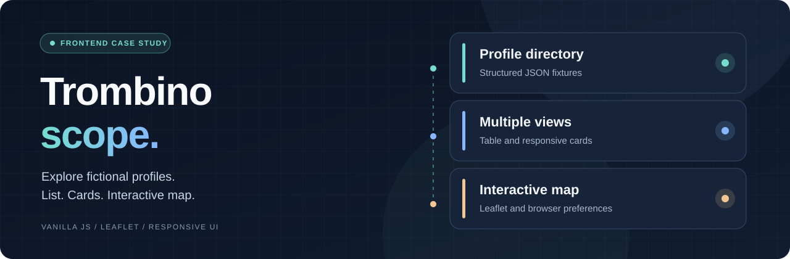

<p align="center"></p>

<h1 align="center">Trombinoscope</h1>

<p align="center"><strong>A fictional-profile directory built with vanilla JavaScript, responsive views and an interactive Leaflet map.</strong></p>

<p align="center"><a href="README.fr.md">Lire en français</a> · <a href="#overview">Overview</a> · <a href="#features">Features</a> · <a href="#architecture">Architecture</a> · <a href="#getting-started">Run locally</a> · <a href="#quality">Quality</a> · <a href="#faq">FAQ</a> · <a href="#license">License</a></p>

<p align="center"> </p>

<a id="overview"></a>
## Overview

Trombinoscope is a frontend learning project developed during the ENI Web and Mobile Web Developer program. It demonstrates DOM manipulation, JSON-backed rendering, saved display preferences and Leaflet map interactions without a frontend framework.

**Fictional sample data:** all 15 profiles are demonstration fixtures, not actual students. Names, descriptions and city associations were created for the project. Map coordinates serve as illustrative locations.

Visitors can explore the same data in multiple views, open profile details and save display settings without an account.

<a id="features"></a>
## Capabilities

| Feature | Purpose |
| --- | --- |

| **Table view** | Names, locations and direct access to profile details. |
| **Card view** | Responsive profile cards for different screen sizes. |
| **Profile details** | Dynamically displayed biographical information. |
| **Leaflet map** | Geographic markers with profile popups. |
| **Local preferences** | Light/dark theme and preferred view stored in localStorage. |
| **Responsive interface** | Layouts and navigation adapted to smaller devices. |

<a id="architecture"></a>
## Architecture and data

The app is composed of HTML pages, a shared CSS file, vanilla JavaScript and the data/promo.json fixture file. There is no application backend, database or account system. Assets are organized under images/, with secondary pages in pages/.

**Directories :** data/ · css/ · images/ · pages/ · index.html · script.js.

<a id="getting-started"></a>
## Run locally

Start a local HTTP server from the repository root, then open http://localhost:8000. Direct file:// loading may prevent fetch requests for the JSON fixtures.

```bash

git clone https://github.com/hrmonic/trombinoscope.git
cd trombinoscope
python -m http.server 8000

```

Another local HTTP server can also be used.

<a id="quality"></a>
## Quality and limitations

The code separates fixture data from rendering and stores settings in the browser. Basic ARIA labels and responsive interactions are present, but no accessibility certification or automated test suite is claimed. Some page titles and asset paths still reflect the original training-project identity and require cleanup.

### Potential improvements

- Add profile search, filtering and sorting.
- Improve keyboard focus management within profile dialogs.
- Normalize titles and asset paths for subdirectory hosting.
- Add automated tests and actual UI screenshots.

<a id="faq"></a>
## Frequently asked questions

### Are these real student profiles?

No. All 15 records are fictional demonstration fixtures.

### Does the project need a database?

No. Profile records are loaded from a local JSON file.

### Does it use a frontend framework?

No. It uses native HTML, CSS and JavaScript, alongside Leaflet for the map.

### Are preferences remembered?

Yes. The chosen theme and view are stored locally in the browser.

<a id="license"></a>
## License and maintainer

This repository does not currently include a license file. Public access to source code does not automatically grant redistribution or reuse rights; an explicit license may be added later.

**Maintainer:** [Réda Touzani](https://github.com/hrmonic).

---

*Frontend learning project — all directory records are fictional.*
